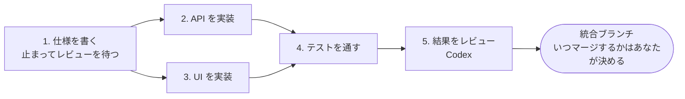

# CodeDAG プラグインマーケットプレイス

**CodeDAG Guide プラグイン（`codedag@codedag`）は、Claude Code と Codex が [CodeDAG](https://codedag.com/ja) を使えるようにします。このマーケットプレイスに現在収録されている唯一のプラグインです。**

[インストール](#インストールして使い始める) · [ウェブサイト](https://codedag.com/ja) · [ドキュメント](https://codedag.com/ja/docs) · [CodeDAG リポジトリ](https://github.com/CodedagAI/codedag-home) · [English](./README.md) · [简体中文](./README.zh.md) · 日本語

コーディングエージェントをそのまま使うと、作業は一往復ずつ進みます。1 つ頼んで終わるのを待ち、結果を確認してから次を頼む、の繰り返しです。席を外せば、どのセッションも止まります。CodeDAG とこのプラグインがあれば、やりたいことをすべて一度に Claude Code や Codex に伝えるだけで済みます。これまで一往復ずつ頼んでいた作業を、エージェントがタスクに分け、CodeDAG のワークフローに書いて投入します。CodeDAG はタスクを依存関係の順に実行し、各タスクは新しいエージェントセッションで、専用のブランチ上で進みます。終わったタスクの結果は自動でマージされ、コンフリクトが起きても自動で解決されます。その間、あなたとやり取りしているエージェントが進捗を確認し、すべてのタスクが終わったら結果を報告します。

CodeDAG はすでに使っているものの、プラグインはまだという方は、プラグインを入れれば、ワークフローファイルの作成も `cdg` コマンドの実行も自分でする必要がなくなります。エージェントがまずワークフローを書いて見せ、検証してから投入し、実行を見守ります。あらかじめ取り決めた範囲で許可リクエストに応答し、レビューを進め、最後に各タスクが何をしたか、結果がどこにあるかを伝えます。

## 動作の例

エージェントにこう頼みます。

> CodeDAG でドキュメントサイトに検索機能を追加して。まず仕様を書いて、私のレビューを待って。そのあと API と UI を並行して実装して、テストが通るまで直して、最後に Codex に結果をレビューさせて。

エージェントは次のようなワークフローを書いて見せ、確認が取れてから投入します。



各タスクは、上流のタスクが承認されるとすぐに始まります。その時点で、上流の結果はすでにそのタスクのブランチにマージされています。タスク 2 と 3 は互いに依存しないので、CodeDAG 用の worktree を用意しておけば、それぞれ別の worktree で同時に実行されます（用意の仕方は[並列実行とワークスペース](https://codedag.com/ja/docs/guides/parallel-workspaces)を参照）。結果は最後に自動で 1 本の統合ブランチにまとまり、メインブランチは最初から最後まで変わりません。

## 頼めること

以下では、CodeDAG に任せるのに向いている作業を場面ごとに挙げ、依頼のおおよその伝え方を示します。依頼の中で、CodeDAG を使うことをはっきり伝えてください。そうしないと、エージェントはワークフローを書かずに、今のセッションで直接変更を始めることがあります。

- **複数の作業を並行して進める：** 互いに関係のない変更でも、1 つの計画を分割した各部分でも、それぞれを 1 つのタスク、または一連のタスクにして、専用のブランチで同時に進めます。終わったら、結果は自動でまとめてマージされます。同時に進めるには、先に CodeDAG 用の worktree を用意してください。
  > うちのタスクボード（GitHub Issues か Linear）から、私に割り当てられた issue を 5 つ選んで、1 つの CodeDAG ワークフローで実装して。issue ごとに、計画の作成、計画のレビュー、実装、コードのレビューと修正を順に行う一連のタスクを作り、同じワークフローの中で 5 件を並列に実行して。
- **時間のかかる複雑な作業を自動で進める：** 以前なら 1 人で 1 か月かかった大きな機能も、計画、各モジュールの実装、データ移行、テスト、レビューなど、十数個のタスクに分けられます。各タスクは新しいセッションで始まるので、コンテキストが膨らみ続けることはありません。前のステップが承認されるとすぐに次が始まり、止まるのは指定した箇所でレビューを待つときだけです。
  > CodeDAG でこのアプリにチーム機能とマルチテナント対応を追加して。要件は docs/requirements/multi-tenant.md にある。まず既存のコードを読んで、全体の計画と分割案を書き、私のレビューを待って。次に計画に沿って、データ分離、メンバー招待、ロールベースの権限管理、既存データの移行をモジュールごとに実装して。各モジュールはテストを先に書いてから実装して。最後に、全テストが通るまで直して、全体をレビューして。
- **夜のあいだに無人で進める：** ワークフローを投入したら席を外してかまいません。張り付いていなくてもタスクは順に進み、翌朝に結果を確認できます。
  > CodeDAG で src/legacy/ のモジュールを新しい API に移行して。1 モジュールにつき 1 タスクで、順番に、無人実行で最後まで進めて。
- **コードを自動でレビューする：** 同じ変更を別々のエージェントやモデルにレビューさせ、1 つのタスクで指摘をまとめて、妥当なものを直します。
  > CodeDAG で、今のブランチの main との差分をレビューして。Claude Code と Codex にそれぞれレビューさせ、両方の指摘をまとめて、妥当なものを直して。
- **いつもの手順を 1 つのワークフローにまとめる：** 使い慣れたスキル、コマンド、スクリプトをそれぞれ 1 つのタスクにして、最初から最後までの流れにつなげれば、毎回同じ手順で実行できます。
  > CodeDAG でうちの開発手順を 1 本のワークフローにまとめて。まず write-spec スキルで計画を書き、計画に沿って実装し、code-review スキルでレビューして直し、最後に scripts/release-check.sh でリリース前のチェックをして。

## プラグインと CodeDAG CLI

プラグインはエージェントに CodeDAG の使い方を教え、実行は CLI が担います。両者は別々にリリースされ、それぞれ更新されます。

- **プラグイン：** `codedag-guide` スキルが入っていて、作業をタスクに分けてワークフローを書き、`cdg` で投入、追跡、レビューする方法をエージェントに教えます。プラグイン自体はタスクを実行せず、CLI も含んでいません。
- **CodeDAG CLI：** コマンド名は `cdg` です。手元のマシンで、普段使っている Claude Code と Codex を呼び出してワークフローを実行します。依存関係に従ってタスクをスケジュールし、各タスクに新しいセッションと専用のブランチを割り当て、結果を自動で統合ブランチにマージします。実行中はいつでも進捗を確認でき、タスクのセッションに入ってエージェントと直接やり取りしたり、タスクを一時停止、強制停止、復旧したりできます。指定したタスクが終わったところで止め、レビューを待たせることもできます。

詳しくは [CodeDAG リポジトリ](https://github.com/CodedagAI/codedag-home)と[ドキュメント](https://codedag.com/ja/docs)をご覧ください。

## インストールして使い始める

### 1. 前提条件を満たす

前提条件をそろえる作業は、エージェントに任せることもできます。その場合は、ステップ 2 の[方法 1](#方法-1エージェントにインストールを任せる)に進んでください。

1. **Claude Code か Codex がインストールされていること：** CodeDAG が現在サポートしているのは、この 2 つのエージェントだけです。
2. **CodeDAG CLI がインストールされていること：** `cdg --version` を実行してバージョン番号が表示されれば、インストール済みです。インストールされていない場合は、[インストールとログイン](https://codedag.com/ja/docs/get-started/installation)の手順でインストールします。
3. **CodeDAG にログインしていること：** `cdg auth status --local` を実行して、`Signed in` で始まる行が表示されれば（終了コードは 0）ログイン済みです。ログインしていない場合は `cdg auth login` を実行します。ブラウザーでログインページが開くので、Google アカウントでログインしてください。初めてログインしたときに CodeDAG アカウントも作成されます。コマンドはログインが終わるまで待ちます。CodeDAG は現在プライベートベータで、ログインには招待が必要です。招待はメールで順次お送りします。[ウェイトリストに登録](https://codedag.com/ja/waitlist?source=plugin-readme)して、招待をお待ちください。

### 2. プラグインをインストールする（3 つの方法から 1 つを選ぶ）

#### 方法 1：エージェントにインストールを任せる

次のプロンプトを、Claude Code や Codex など、コマンドを実行できるエージェントに貼り付けます。エージェントはステップ 1 の前提条件を確認して、満たされていないものに対処し、方法 2 でプラグインをインストールし、ステップ 3 のとおりに確認します。

```text
https://raw.githubusercontent.com/CodedagAI/codedag-plugin-marketplace/main/README.ja.md の「インストールして使い始める」に従って、このマシンに CodeDAG と CodeDAG Guide プラグインをインストールして。まず「1. 前提条件を満たす」を 1 つずつ確認し、満たされていないものはそこに書かれた方法で対処して。次に「方法 2：cdg でインストールする」でプラグインをインストールし、最後に「3. インストールを確認する」のとおりに確認して。私の操作や判断が必要なときだけ止まって聞き、それ以外は最後まで進めて。すべて終わったら結果を伝え、「4. 使い始める」に沿って次に何をすればいいか教えて。
```

#### 方法 2：cdg でインストールする

初めてインストールするときも、あとから追加するとき（たとえば別のエージェントを入れたとき）も、このコマンドを使います。

```sh
cdg plugin install
```

このマシンにある各エージェントにプラグインをインストールします。すでにプラグインが入っているエージェントはスキップします。インストール先は User スコープなので、すべてのリポジトリで使えます。リポジトリを通じてチームと共有したい場合は、[インストールスコープ](https://codedag.com/ja/docs/guides/guide-plugin#scopes)をご覧ください。

自分で `cdg init` を実行してリポジトリを初期化するときも、エージェントごとにプラグインをインストールするか聞かれます。`User-level` を選べば、上のコマンドと同じ結果になります。

#### 方法 3：Claude Code や Codex 自身のコマンドでインストールする

プラグインをすべてエージェント側でまとめて管理したい場合は、この方法が使えます。インストールされるプラグインは方法 2 と同じで、同じく User スコープに入り、あとから `cdg plugin` で確認や更新もできます。違うのは、1 回に 1 つのエージェントにしかインストールしない点だけです。

Claude Code：

```sh
claude plugin marketplace add CodedagAI/codedag-plugin-marketplace
claude plugin install codedag@codedag
```

Codex：

```sh
codex plugin marketplace add CodedagAI/codedag-plugin-marketplace
codex plugin add codedag@codedag
```

### 3. インストールを確認する

リポジトリで `cdg plugin status` を実行し、使っているエージェントの項目に `No action needed` と表示されれば、インストールは完了しています。別の内容が表示された場合は、`Action` の行に示されたコマンドで対処してください。それでも解決しないときは、[CodeDAG Guide プラグインを管理する](https://codedag.com/ja/docs/guides/guide-plugin)の「よくある質問」をご覧ください。

### 4. 使い始める

プラグインは新しいセッションでしか有効にならないので、Claude Code か Codex のセッションを新しく開きます。

- **CodeDAG を初めて使う場合：** [エージェントにオーケストレーションを任せる](https://codedag.com/ja/docs/get-started/let-your-agent-orchestrate#paste-prompt)から始めるのがおすすめです。そのページには、そのまま貼り付けて使えるプロンプトがあり、プロンプトの各部分の役割も説明されています。このプロンプトでは、エージェントがリポジトリから小さな TODO を 2 つ見つけて、それぞれ実装します。そのため、普段開発している Git リポジトリで試すのがよいでしょう。そのリポジトリのルートで新しいセッションを開き、プロンプトを貼り付けるだけです。エージェントはまずワークフローを書いて見せ、確認が取れてから投入し、最後まで見届けて結果を報告します。
- **CodeDAG をすでに使っている場合：** 作業したいリポジトリで新しいセッションを開き、手元の作業をそのまま任せてみてください。CodeDAG を使うことをはっきり伝え、投入する前にワークフローを見せるよう頼めば、普段の自分の書き方と照らし合わせて確認、修正できます。アクセスレベル、ワークスペース、手動レビューのように普段は自分で決めていることは、依頼の中で伝えれば十分です。詳しくは[投入前にエージェントと確認しておく 3 つのこと](https://codedag.com/ja/docs/get-started/let-your-agent-orchestrate#confirm-before-submit)をご覧ください。すでに実行中のワークフローを引き継がせ、進捗を見守ってもらうところから始めることもできます。

## 更新とアンインストール

### 更新

```sh
cdg plugin update
```

Codex は起動するたびにこの marketplace を更新し、プラグインに変更があれば入れ直します。Claude Code はデフォルトでは自動更新しません。`/plugin` の **Marketplaces** タブで `codedag` の自動更新を有効にできます。

<details>
<summary>Claude Code や Codex 自身のコマンドで更新する</summary>

Claude Code：

```sh
claude plugin update codedag@codedag
```

Codex：

```sh
codex plugin marketplace upgrade codedag
```

</details>

### アンインストール

```sh
cdg plugin uninstall
```

インストールスコープごとの違いや、このコマンドでどこにインストールしたプラグインが削除されるかは、[CodeDAG Guide プラグインを管理する](https://codedag.com/ja/docs/guides/guide-plugin#change-scope)をご覧ください。

<details>
<summary>Claude Code や Codex 自身のコマンドでアンインストールする</summary>

Claude Code：

```sh
claude plugin uninstall codedag@codedag
```

Codex：

```sh
codex plugin remove codedag@codedag
```

marketplace ごと削除するには、`claude plugin marketplace remove codedag` または `codex plugin marketplace remove codedag` を実行します。

</details>

## このマーケットプレイスのプラグイン

現在収録しているのは公式プラグインだけです。今後は、CodeDAG と組み合わせて使うほかのプラグインも収録します。たとえば、ワークフローの開始前や終了後の工程を担うプラグインや、CodeDAG のワークフローを使って特定の種類のタスクをこなすプラグインです。

| プラグイン | ID | エージェントに追加される機能 |
|---|---|---|
| CodeDAG Guide（公式） | `codedag@codedag` | `codedag-guide` スキル：CodeDAG のワークフローを書き、投入し、見守り、レビューする方法 |

## プラグインを掲載したい方へ

このマーケットプレイスは、まだ掲載の申し込みを受け付けていません。CodeDAG と組み合わせて使うプラグインを作っている場合は、hi@codedag.com へのメールか [Issue](https://github.com/CodedagAI/codedag-home/issues/new/choose) で、プラグインについてお知らせください。受け付けを始めるときに、掲載の基準と手順をここに追加します。

## フィードバック

プラグインや CodeDAG の問題は、[CodeDAG リポジトリの Issue](https://github.com/CodedagAI/codedag-home/issues/new/choose) で報告してください。公開の場で話せない問題は、hi@codedag.com までメールでご連絡ください。セキュリティ上の脆弱性の報告については [SECURITY.md](https://github.com/CodedagAI/codedag-home/blob/main/SECURITY.md) をご覧ください。

## ライセンス

このリポジトリは [MIT ライセンス](LICENSE)で提供しています。CodeDAG の名称とロゴはライセンスの対象外です。

このプラグインは CodeDAG CLI と組み合わせて使いますが、CLI はこのリポジトリには含まれていません。Zillion AI LLC のプロプライエタリソフトウェアで、[CodeDAG 利用規約](https://codedag.com/ja/terms)に基づいて利用が許諾されます。
