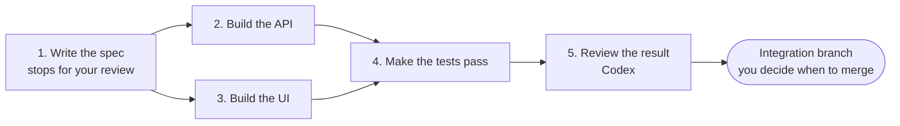

# CodeDAG Plugin Marketplace

**The CodeDAG Guide plugin (`codedag@codedag`) teaches Claude Code and Codex to use [CodeDAG](https://codedag.com). It's also the only plugin in this marketplace so far.**

[Install](#install-and-get-started) · [Website](https://codedag.com) · [Docs](https://codedag.com/docs) · [CodeDAG repository](https://github.com/CodedagAI/codedag-home) · English · [简体中文](./README.zh.md) · [日本語](./README.ja.md)

On its own, a coding agent works one request at a time: you ask for something, wait for it to finish, check the result, then ask for the next thing. Step away, and every session sits idle. With CodeDAG and this plugin, you hand Claude Code or Codex everything you want done in one go. Your agent breaks it into tasks, the pieces of work you'd otherwise hand over one request at a time, writes them up as a CodeDAG workflow, and submits it. CodeDAG runs the tasks in dependency order, each in a fresh agent session on its own branch. As each task finishes, CodeDAG merges its results and resolves any conflicts automatically. Meanwhile, the agent you're talking to checks on progress and reports back when all the tasks are done.

Already using CodeDAG without the plugin? Install it, and you no longer have to write workflow files or run `cdg` commands yourself. Your agent writes the workflow, shows it to you, then validates and submits it. After that, it watches the run for you: it responds to approval requests within the limits you set, keeps reviews moving, and when everything's done, tells you what each task did and where to find the results.

## See it in action

Ask your agent:

> Use CodeDAG to add search to the docs site. Write the spec first and let me review it. Then build the API and the UI in parallel, make the tests pass, and finally have Codex review the result.

It writes a workflow like the one below, shows it to you, and submits it once you confirm:



A task starts as soon as its upstream tasks are accepted, with their results already merged into its branch. Tasks 2 and 3 don't depend on each other, so once you've set up worktrees for CodeDAG, they run at the same time, each in its own worktree (see [Run in Parallel with Workspaces](https://codedag.com/docs/guides/parallel-workspaces)). All results end up on one integration branch automatically, and your main branch stays untouched throughout.

## What you can ask for

The examples below show the kinds of work CodeDAG is good for, and roughly how to ask for each. Say in your request that you want to use CodeDAG, so your agent writes a workflow instead of making the changes itself in the current session.

- **Several pieces of work at once:** whether they're unrelated changes or parts of the same plan, each gets its own task or chain of tasks and runs in parallel on its own branch. When they finish, the results are merged together automatically. To run them at the same time, set up worktrees for CodeDAG first.
  > From our task board (GitHub Issues or Linear), pick five issues assigned to me and implement them in a single CodeDAG workflow, with one chain of tasks per issue and all five chains running in parallel. Each chain: write a plan, review it, implement it, then review the code and fix whatever comes up.
- **Long-running, complex work:** a feature that would once have taken one person a month can be split into a dozen or so tasks: the plan, each module's implementation, data migration, tests, and reviews. Every task begins in a fresh session, so the context never piles up, and each one starts as soon as the previous one is accepted. Work pauses for your review only at the points you've specified.
  > Use CodeDAG to add teams and multi-tenancy to this app; the requirements are in docs/requirements/multi-tenant.md. First, read the existing code and write an overall plan and a task breakdown, then wait for my review. Then build it module by module, following the plan: data isolation, member invitations, role-based permissions, and migrating existing data. Write the tests first for each module. Finally, get the full test suite passing and do an overall review.
- **Unattended overnight runs:** once you've submitted, you can walk away. The tasks run one after another with no one watching, and you check the results in the morning.
  > Use CodeDAG to migrate the modules in src/legacy/ to the new API, one module per task, in sequence, and let it run unattended until it's done.
- **Automated code review:** have different agents or models review the same change, then have one task combine their findings and fix the ones that hold up.
  > Use CodeDAG to review the changes on the current branch against main. Have Claude Code and Codex each review them, then combine both reviews and fix the issues that hold up.
- **Your existing process, end to end:** the skills, commands, or scripts you already rely on can each go into a task, chained into an end-to-end process that runs the same way every time.
  > Use CodeDAG to turn our development process into one workflow: write a plan with the write-spec skill, implement it, review and fix it with the code-review skill, and finally run scripts/release-check.sh for the pre-release checks.

## The plugin and the CodeDAG CLI

The plugin teaches your agent to use CodeDAG, and the CLI does the running. They're released and updated separately.

- **The plugin:** contains the `codedag-guide` skill, which teaches your agent to split work into tasks and write workflows, then submit, track, and review them with `cdg`. The plugin itself doesn't run tasks or include the CLI.
- **The CodeDAG CLI (`cdg`):** runs workflows on your machine with the Claude Code and Codex you already use. It schedules tasks by their dependencies, gives each task a fresh session and its own branch, and merges the results into an integration branch automatically. While a workflow runs, you can check its progress at any time, enter a task's session to talk to the agent directly, or pause, kill, and recover tasks. You can also have specific tasks stop when they finish and wait for your review.

See the [CodeDAG repository](https://github.com/CodedagAI/codedag-home) and the [docs](https://codedag.com/docs) for more.

## Install and get started

### 1. Meet the prerequisites

You can also leave these to your agent: skip to [Option 1](#option-1-let-your-agent-install-it) in step 2.

1. **Claude Code or Codex is installed:** CodeDAG currently supports only these two agents.
2. **The CodeDAG CLI is installed:** `cdg --version` should print a version number. If it doesn't, follow [Installation and Sign-In](https://codedag.com/docs/get-started/installation).
3. **You're signed in to CodeDAG:** `cdg auth status --local` should print a line starting with `Signed in` (exit code 0). If not, run `cdg auth login`: it opens a sign-in page in your browser, where you sign in with Google, and waits until you're done. Your CodeDAG account is created the first time you sign in. CodeDAG is in private beta, so you need an invite to sign in. Invites go out by email in batches; [join the waitlist](https://codedag.com/waitlist?source=plugin-readme) to get one.

### 2. Install the plugin (pick one of three options)

#### Option 1: Let your agent install it

Paste the prompt below into Claude Code, Codex, or another agent that can run commands. Your agent works through the prerequisites in step 1 and sets up anything that's missing, installs the plugin using Option 2, then verifies the install with step 3.

```text
Install CodeDAG and the CodeDAG Guide plugin on this machine by following the "Install and get started" section of https://raw.githubusercontent.com/CodedagAI/codedag-plugin-marketplace/main/README.md. First, go through each item in "1. Meet the prerequisites" and set up anything that's missing the way it describes. Then install the plugin with "Option 2: Install with cdg" and verify it with "3. Check the installation". Only stop to ask me when you need me to do something or make a decision; otherwise keep going. When you're done, tell me how it went and what to do next, based on "4. Get started".
```

#### Option 2: Install with cdg

Run this to install the plugin for the first time, and again whenever you install another agent:

```sh
cdg plugin install
```

It installs the plugin for each agent on your machine, skipping any that already have it. The plugin is installed in the user scope, so it works in all your repositories. To share it with your team through the repository instead, see [installation scopes](https://codedag.com/docs/guides/guide-plugin#scopes).

If you set up a repository with `cdg init` yourself, it also asks whether to install the plugin for each agent. Choosing `User-level` has the same effect as the command above.

#### Option 3: Install directly with Claude Code or Codex

Choose this if you prefer to manage all your plugins in the agent itself. It installs the same plugin as Option 2, in the same user scope, and you can still check and update it with `cdg plugin`. The only difference is that you install it for one agent at a time.

Claude Code:

```sh
claude plugin marketplace add CodedagAI/codedag-plugin-marketplace
claude plugin install codedag@codedag
```

Codex:

```sh
codex plugin marketplace add CodedagAI/codedag-plugin-marketplace
codex plugin add codedag@codedag
```

### 3. Check the installation

Run `cdg plugin status` in your repository. If it shows `No action needed` for the agent you use, you're all set. Otherwise, run the command on the `Action` line. If that doesn't fix it, see Common questions in [Manage the CodeDAG Guide Plugin](https://codedag.com/docs/guides/guide-plugin).

### 4. Get started

The plugin only takes effect in new sessions, so start a new Claude Code or Codex session.

- **New to CodeDAG:** start with [Let Your Agent Orchestrate](https://codedag.com/docs/get-started/let-your-agent-orchestrate#paste-prompt). That page has a prompt you can paste as is, and explains what each part of it does. The prompt has your agent find two small TODOs in your repository and implement each one, so it's best to try it in a Git repository you're actively working on: start a new session at its root and paste in the prompt. Your agent writes the workflow, shows it to you, submits it once you confirm, then sees it through and reports back.
- **Already using CodeDAG:** start a new session in the repository you want to work on, and give your agent a piece of what you're working on now. Say that you want to use CodeDAG, and ask your agent to show you the workflow before submitting, so you can check and adjust it the way you'd write it yourself. You can spell out anything you'd normally decide yourself, such as the access level, workspaces, and manual review, right in your request; see [Three things to agree on before it submits](https://codedag.com/docs/get-started/let-your-agent-orchestrate#confirm-before-submit). You can also start by having it take over a workflow that's already running and keep an eye on its progress for you.

## Update and uninstall

### Update

```sh
cdg plugin update
```

Codex refreshes this marketplace each time it starts, and reinstalls the plugin when it has changed. Claude Code doesn't update it automatically by default; you can turn on auto-update for `codedag` in the **Marketplaces** tab of `/plugin`.

<details>
<summary>Update directly with Claude Code or Codex</summary>

Claude Code:

```sh
claude plugin update codedag@codedag
```

Codex:

```sh
codex plugin marketplace upgrade codedag
```

</details>

### Uninstall

```sh
cdg plugin uninstall
```

See [Manage the CodeDAG Guide Plugin](https://codedag.com/docs/guides/guide-plugin#change-scope) for how installation scopes differ and which installations this command removes.

<details>
<summary>Uninstall directly with Claude Code or Codex</summary>

Claude Code:

```sh
claude plugin uninstall codedag@codedag
```

Codex:

```sh
codex plugin remove codedag@codedag
```

To remove the marketplace as well, run `claude plugin marketplace remove codedag` or `codex plugin marketplace remove codedag`.

</details>

## Plugins in this marketplace

For now, this marketplace lists only the official plugin. Later, it will also list other plugins that work with CodeDAG, such as plugins that handle a step before or after a workflow run, or plugins that use CodeDAG workflows to do a particular kind of task.

| Plugin | ID | What it gives your agent |
|---|---|---|
| CodeDAG Guide (official) | `codedag@codedag` | The `codedag-guide` skill: how to write, submit, supervise, and review CodeDAG workflows |

## Add your plugin

Building a plugin that works with CodeDAG? This marketplace isn't accepting submissions yet. Email hi@codedag.com or open an [issue](https://github.com/CodedagAI/codedag-home/issues/new/choose) to tell us about it. We'll add submission guidelines here when submissions open.

## Feedback

Report problems with the plugin or CodeDAG by [opening an issue](https://github.com/CodedagAI/codedag-home/issues/new/choose) in the CodeDAG repository. For anything you'd rather not discuss in public, email hi@codedag.com. To report a security vulnerability, see [SECURITY.md](https://github.com/CodedagAI/codedag-home/blob/main/SECURITY.md).

## License

This repository is licensed under the [MIT License](LICENSE). The CodeDAG name and logo aren't covered by the license.

The plugin works with the CodeDAG CLI, but the CLI isn't in this repository. It's proprietary software of Zillion AI LLC, licensed under the [CodeDAG Terms of Service](https://codedag.com/terms).
