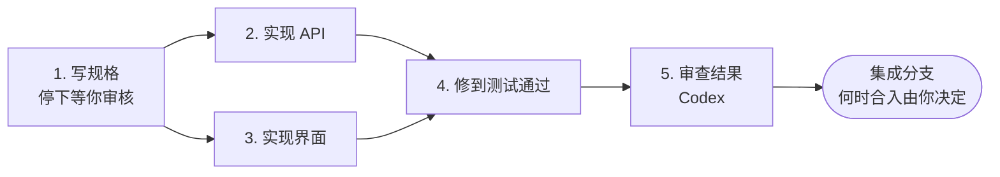

# CodeDAG 插件市场

**CodeDAG Guide 插件（`codedag@codedag`）让 Claude Code 与 Codex 会用 [CodeDAG](https://codedag.com/zh)，也是这个插件市场目前收录的唯一一个。**

[安装](#安装并开始使用) · [官网](https://codedag.com/zh) · [文档](https://codedag.com/zh/docs) · [CodeDAG 仓库](https://github.com/CodedagAI/codedag-home) · [English](./README.md) · 简体中文 · [日本語](./README.ja.md)

直接使用编程 Agent 时，工作是一轮一轮推进的：你交代一件事，等它做完，检查结果，再交代下一件；你一离开，所有会话都停下。有了 CodeDAG 和这个插件，你只要把所有要做成的事一次交代给 Claude Code 或 Codex，它就会把原本要你一轮一轮交代的工作拆成一个个任务，写成 CodeDAG 工作流并提交。CodeDAG 按依赖顺序执行这些任务，每个任务都开一个全新的 Agent 会话，在自己的分支上进行，完成后结果自动合并，遇到冲突也会自动解决。与此同时，和你对话的 Agent 替你查看进度，所有任务做完后向你汇报。

如果你已经在用 CodeDAG，但还没有安装插件，装上之后，你就不必再自己写工作流文件、运行 `cdg` 命令。Agent 会把写好的工作流先给你看，校验后提交，再替你盯着执行：在你约定的范围内应答审批，推进审核，最后告诉你每个任务做了什么、结果在哪里。

## 看一个例子

对 Agent 说：

> 用 CodeDAG 给文档站加上搜索。先写规格，写完让我审核。然后并行实现 API 和界面，修到测试通过，最后让 Codex 审查结果。

它会写出类似下面的工作流，先给你看，等你确认后再提交：



一个任务的上游一被接受，它就立即开始，这时上游的结果已经自动合并进它的分支。任务 2 和任务 3 互不依赖，你为 CodeDAG 准备好 worktree 之后，它们就各在自己的 worktree 里同时执行（准备方法见[并行执行与工作区](https://codedag.com/zh/docs/guides/parallel-workspaces)）。所有结果最后自动汇到一条集成分支上，你的主分支始终保持不变。

## 可以让它做什么

下面按场景举几个适合交给它的工作，并给出请求大致怎么说。请求里要点明用 CodeDAG 来做，Agent 才会写成工作流，而不是直接在当前会话里动手改。

- **同时推进几项开发：** 不管是互不相关的几项改动，还是按同一份方案拆开的几部分，都可以各用一个任务或一条任务链，在自己的分支上同时推进，做完后自动合并到一起。要同时推进，先为 CodeDAG 准备好 worktree。
  > 从我们的任务看板（GitHub Issues 或 Linear）里挑出 5 个分配给我的 issue，写成一个 CodeDAG 工作流来实现：每个 issue 一条任务链，依次写方案、审查方案、实现、审查代码并修复；5 条任务链并行执行。
- **长时间自动完成复杂任务：** 一项放在以前要一个人做一个月的大功能，可以拆成方案、各模块的实现、数据迁移、测试和审查等十几个任务。每个任务都在全新的会话里开始，上下文不会越拉越长；前一步被接受后，下一步自动接上，只在你指定的地方停下来等你审核。
  > 用 CodeDAG 给这个应用加上团队与多租户支持，需求见 docs/requirements/multi-tenant.md。先读懂现有代码，写出整体方案和拆分计划，等我审核；再按方案逐个模块实现数据隔离、成员邀请、角色权限和现有数据的迁移，每个模块先写测试再实现；最后跑全量测试修到通过，并做一次整体审查。
- **夜里无人值守地跑：** 提交之后你就可以离开，任务一个接一个跑下去，不用守着，第二天回来看结果。
  > 用 CodeDAG 把 src/legacy/ 下的模块逐个迁移到新 API，每个模块一个任务，依次执行，无人值守地跑完。
- **自动审查代码：** 让不同的 Agent 或模型分别审查同一份改动，再由一个任务汇总意见、修掉确实成立的问题。
  > 用 CodeDAG 审查当前分支相对 main 的改动：让 Claude Code 和 Codex 各审一遍，再汇总两份意见，修掉确实成立的问题。
- **把已有的做法串成完整的工作流：** 你平时用惯的技能、命令或脚本，可以各放进一个任务，串成从头到尾的完整流程，以后每次都照这个流程跑。
  > 用 CodeDAG 把我们的开发流程串起来：先用 write-spec 技能写方案，再按方案实现，然后用 code-review 技能审查并修复，最后运行 scripts/release-check.sh 做发布前检查。

## 插件与 CodeDAG CLI

插件教 Agent 使用 CodeDAG，CLI 负责执行，两者分开发布、各自更新。

- **插件：** 里面是 `codedag-guide` 技能，教 Agent 怎样拆分任务、写工作流，再用 `cdg` 提交、跟踪和审核。插件本身不执行任务，也不包含 CLI。
- **CodeDAG CLI：** 命令是 `cdg`。它在你的电脑上调用你已经在用的 Claude Code 和 Codex 来执行工作流：按依赖调度任务，每个任务一个全新的会话、一条自己的分支，结果自动合并到集成分支。工作流运行期间，你可以随时查看进度、进入某个任务的会话直接和 Agent 对话，或者暂停、中断和恢复任务；也可以让指定的任务做完后停下，等你审核再继续。

更多介绍见 [CodeDAG 仓库](https://github.com/CodedagAI/codedag-home)和[文档](https://codedag.com/zh/docs)。

## 安装并开始使用

### 1. 满足前提

下面这些前提也可以直接交给 Agent 处理，这时跳到第 2 步的[方式一](#方式一交给-agent-安装)即可。

1. **已装有 Claude Code 或 Codex：** CodeDAG 目前只支持这两个 Agent。
2. **已装好 CodeDAG CLI：** 运行 `cdg --version` 能输出版本号。没有装时，按[安装与登录](https://codedag.com/zh/docs/get-started/installation)安装。
3. **已登录 CodeDAG：** 运行 `cdg auth status --local`，如果输出以 `Signed in` 开头的一行（退出码为 0），就表示已登录。没有登录时，运行 `cdg auth login`。这条命令会在浏览器里打开登录页，你用 Google 账号登录即可，命令会一直等到登录完成才结束；第一次登录时会同时创建 CodeDAG 账号。CodeDAG 目前处于内测，收到邀请才能登录。邀请分批通过邮件发出，可以先[加入 Waitlist](https://codedag.com/zh/waitlist?source=plugin-readme) 等待。

### 2. 安装插件（三种方式，任选其一）

#### 方式一：交给 Agent 安装

把下面这段提示词贴给 Claude Code、Codex 等能运行命令的 Agent。它会先按第 1 步检查前提，替你处理没满足的，再按方式二装好插件，最后按第 3 步确认。

```text
按 https://raw.githubusercontent.com/CodedagAI/codedag-plugin-marketplace/main/README.zh.md 的“安装并开始使用”一节，帮我在这台电脑上装好 CodeDAG 和 CodeDAG Guide 插件：先按“1. 满足前提”逐条确认，不满足的按其中的做法处理；再按“方式二：用 cdg 安装”装好插件；最后按“3. 确认装好”检查。只在需要我动手或做决定时停下来问我，其余的直接做完。全部完成后告诉我结果，并按“4. 开始使用”告诉我下一步怎么做。
```

#### 方式二：用 cdg 安装

首次安装和以后补装（比如新装了另一个 Agent）都运行这条命令：

```sh
cdg plugin install
```

它为这台电脑上的每个 Agent 安装插件，已经装过的 Agent 会跳过；插件装在 User 范围，对你所有的仓库生效。想通过仓库把插件共享给团队，见[安装范围](https://codedag.com/zh/docs/guides/guide-plugin#scopes)。

在某个仓库里自己运行 `cdg init` 初始化时，它也会逐个 Agent 询问要不要安装插件；选 `User-level`，效果与上面这条命令相同。

#### 方式三：用 Claude Code 或 Codex 自己的命令安装

如果你习惯在 Agent 里统一管理所有插件，可以用这种方式。装好的插件与方式二相同，也装在 User 范围，之后同样可以用 `cdg plugin` 查看和更新；唯一的区别是每次只为一个 Agent 安装。

Claude Code：

```sh
claude plugin marketplace add CodedagAI/codedag-plugin-marketplace
claude plugin install codedag@codedag
```

Codex：

```sh
codex plugin marketplace add CodedagAI/codedag-plugin-marketplace
codex plugin add codedag@codedag
```

### 3. 确认装好

在仓库里运行 `cdg plugin status`。如果你用的 Agent 下显示 `No action needed`，就说明装好了；如果显示别的内容，就照 `Action` 一行给出的命令处理，仍然不行再看[管理 CodeDAG Guide 插件](https://codedag.com/zh/docs/guides/guide-plugin)的常见问题。

### 4. 开始使用

插件只在新会话中生效，所以要新开一个 Claude Code 或 Codex 会话。

- **第一次用 CodeDAG：** 推荐从[让 Agent 帮你编排](https://codedag.com/zh/docs/get-started/let-your-agent-orchestrate#paste-prompt)开始，那一页有一段可以直接粘贴的提示词，也讲了提示词的各部分分别起什么作用。这段提示词会让 Agent 在仓库里找出两个小待办，再分别实现，所以最好选一个你正在开发的 Git 仓库来试：在它的根目录新开会话，贴入提示词即可。Agent 会先把写好的工作流给你看，等你确认后再提交，然后一直跟踪到结束，向你汇报。
- **已经用过 CodeDAG：** 在要处理的仓库里新开会话，把手头的一项工作直接交给 Agent。请求里点明用 CodeDAG 来做，并让它先把工作流给你看再提交，这样你可以按自己平时的写法检查、修改。授权、工作区和人工审核平时都由你自己定，在请求里说清楚即可，见[提交前要和它确认的三件事](https://codedag.com/zh/docs/get-started/let-your-agent-orchestrate#confirm-before-submit)。也可以先让它接手一个正在运行的工作流，替你盯着进度。

## 更新与卸载

### 更新

```sh
cdg plugin update
```

Codex 每次启动时都会刷新这个 marketplace，插件有变化就重新安装。Claude Code 默认不会自动更新这个 marketplace，你可以在 `/plugin` 的 **Marketplaces** 标签页里为 `codedag` 打开自动更新。

<details>
<summary>用 Claude Code 或 Codex 自己的命令更新</summary>

Claude Code：

```sh
claude plugin update codedag@codedag
```

Codex：

```sh
codex plugin marketplace upgrade codedag
```

</details>

### 卸载

```sh
cdg plugin uninstall
```

各安装范围的区别，以及这条命令会卸掉哪些地方装的插件，见[管理 CodeDAG Guide 插件](https://codedag.com/zh/docs/guides/guide-plugin#change-scope)。

<details>
<summary>用 Claude Code 或 Codex 自己的命令卸载</summary>

Claude Code：

```sh
claude plugin uninstall codedag@codedag
```

Codex：

```sh
codex plugin remove codedag@codedag
```

想连同 marketplace 一起移除，运行 `claude plugin marketplace remove codedag` 或 `codex plugin marketplace remove codedag`。

</details>

## 已收录的插件

目前只收录官方插件。以后还会收录与 CodeDAG 配合使用的其他插件，比如在工作流开始前或结束后处理某个环节的插件，或者借助 CodeDAG 工作流完成某类专门任务的插件。

| 插件 | 标识 | 为 Agent 增加的能力 |
|---|---|---|
| CodeDAG Guide（官方） | `codedag@codedag` | `codedag-guide` 技能：怎样编写、提交、监督和审核 CodeDAG 工作流 |

## 投稿插件

如果你在做与 CodeDAG 配合使用的插件，这个插件市场目前还不接受投稿，但欢迎发邮件到 hi@codedag.com，或者[提一个 Issue](https://github.com/CodedagAI/codedag-home/issues/new/choose) 介绍你的插件。开放投稿时，我们会在这里补上投稿规范。

## 反馈

插件或 CodeDAG 的问题，请在 [CodeDAG 仓库提 Issue](https://github.com/CodedagAI/codedag-home/issues/new/choose)。不便公开讨论的问题，请发邮件到 hi@codedag.com。报告安全漏洞请见 [SECURITY.md](https://github.com/CodedagAI/codedag-home/blob/main/SECURITY.md)。

## 许可

本仓库采用 [MIT 许可](LICENSE)。CodeDAG 的名称和标志不在许可范围内。

插件要配合 CodeDAG CLI 使用，但 CLI 不在本仓库中。它是 Zillion AI LLC 的专有软件，按 [CodeDAG 服务条款](https://codedag.com/zh/terms)授权使用。
